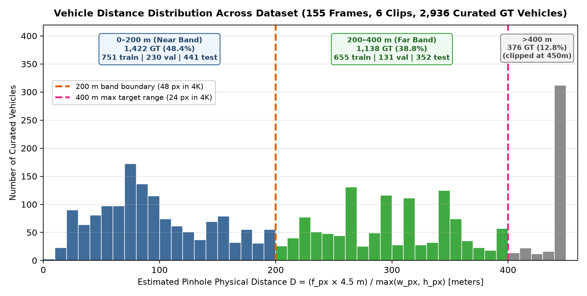
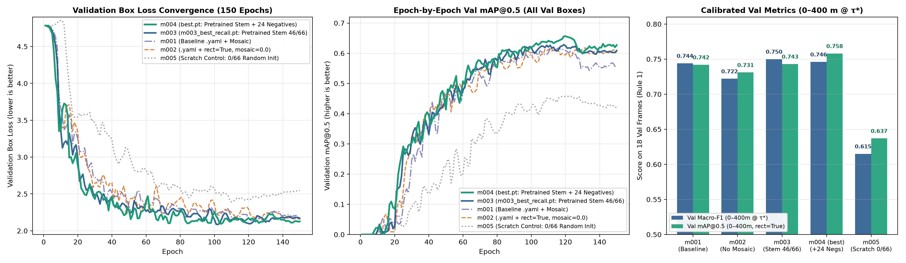
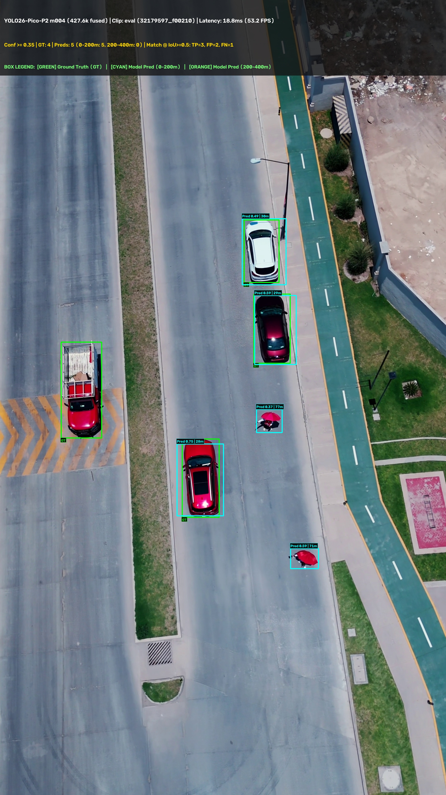
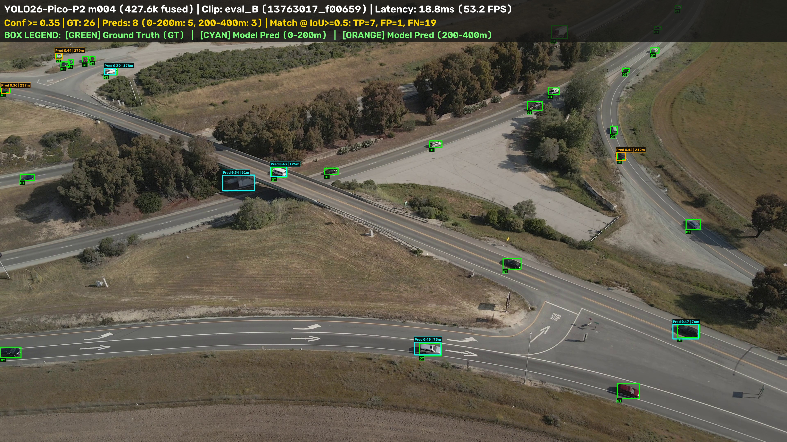
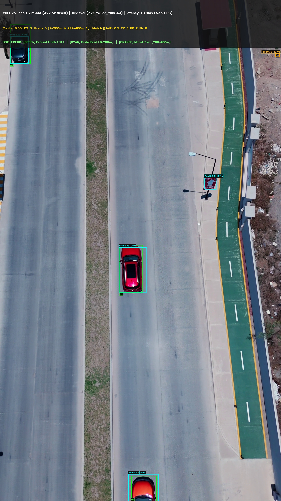
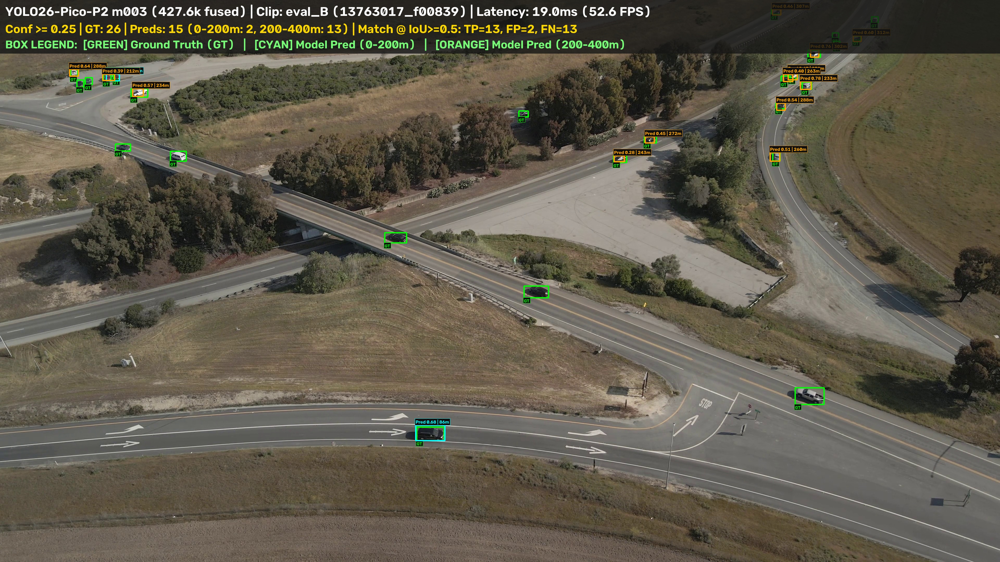

# Aerial Vehicle Detector

Single-class (`vehicle`) aerial detector built on a custom **YOLO26-Pico-P2** architecture (**478,590** unfused / **427,567** fused parameters; **18.8 ms / 53.1 FPS** inference at `imgsz=1024, rect=True`).

**Deliverables:**
- **Weights:** [`weights/best.pt`](weights/best.pt) (`m004` — High-Precision / Urban config, $\tau^*=0.35$) and [`weights/m003_best_recall.pt`](weights/m003_best_recall.pt) (`m003` — High-Recall / Long-Range `200–400 m` config, $\tau^*=0.25$).
- **Visuals & Video:** Sample predictions vs. GT in [`assets/eval_samples/`](assets/eval_samples/), full 30 FPS 4K demo video in [`results/eval_demo_32179597_full_fps.mp4`](results/eval_demo_32179597_full_fps.mp4), and 1 FPS test comparison in [`results/eval_gt_vs_pred_1fps.mp4`](results/eval_gt_vs_pred_1fps.mp4).
- **Side Experiments & Logs:** [`docs/experiments_and_logs.md`](docs/experiments_and_logs.md) | [`data/audit_report.json`](data/audit_report.json) | [`results/eval_metrics.json`](results/eval_metrics.json).

```bash
uv sync --extra dev                                                                     # 1. Install environment
uv run python scripts/03_audit_labels.py                                                # 2. Run label & distance audit
uv run python scripts/04_train.py --mode exp4_pretrained_negatives --pretrained-stem    # 3. Train & calibrate threshold on val
uv run python scripts/05_evaluate.py --weights weights/best.pt                          # 4. Evaluate on test & render videos
```

---

## Data

| Video Link (Pexels) | Role | Resolution & FPS | Scene | Frames (`1 FPS`) | Split | `0–200 m` | `200–400 m` | `>400 m` | Total GT |
| :---: | :---: | :---: | :--- | :---: | :--- | :---: | :---: | :---: | :---: |
| [pexels.com/video/8968356](https://www.pexels.com/video/8968356/) | `train_A` | `1920×1080` @ `29.97` | Highway interchange (oblique) | 19 | `15 train` / `4 val` | 46 | 502 | 218 | **766** |
| [pexels.com/video/5382494](https://www.pexels.com/video/5382494/) | `train_B` | `3840×2160` @ `24.00` | Rural highway, light traffic | 31 | `25 train` / `6 val` | 118 | 146 | 110 | **374** |
| [pexels.com/video/8457857](https://www.pexels.com/video/8457857/) | `train_C` | `3840×2160` @ `23.98` | Simple highway, top-down | 17 | `14 train` / `3 val` | 282 | 134 | 2 | **418** |
| [pexels.com/video/3405804](https://www.pexels.com/video/3405804/) | `train_D` | `3840×2160` @ `29.97` | Urban intersection (nadir) | 24 | `19 train` / `5 val` | 535 | 4 | 0 | **539** |
| [pexels.com/video/32179597](https://www.pexels.com/video/32179597/) | `eval` | `2160×3840` @ `30.00` | City highway, ~30 m nadir (9:16) | 31 | **`31 test`** | **85** | **0** | **0** | **85** |
| [pexels.com/video/13763017](https://www.pexels.com/video/cars-on-roads-and-viaduct-13763017/) | `eval_B` | `3840×2160` @ `59.94` | High-angle oblique highway | 33 | **`33 test`** | **356** | **352** | **46** | **754** |
| **Total** | **6 Clips** | — | — | **155** | **`73 train` / `18 val` / `64 test`** | **1,422** | **1,138** | **376** | **2,936** |

- **Sampling (`1.0 FPS`):** Consecutive frames in 30 FPS drone footage are mostly identical. Sampling at `1.0 FPS` gives 155 diverse frames to curate thoroughly in CVAT and matches the task's rate definition (`False alarms / min = FP * 60 / N_frames`). Extracted frames and raw eval videos download automatically on first run from my public Hugging Face dataset (`ituvtu/aerial-vehicle-detector-data`).
- **Adding a second eval clip (Rule 4):** The primary eval clip ([pexels.com/video/32179597](https://www.pexels.com/video/32179597/)) is a low-altitude (~30 m) vertical top-down shot where all 85 vehicles fall in `0–200 m` and none fall in `200–400 m`. Per Rule 4, I added a second Pexels clip — [https://www.pexels.com/video/cars-on-roads-and-viaduct-13763017/](https://www.pexels.com/video/cars-on-roads-and-viaduct-13763017/) (`eval_B`), a higher-altitude oblique highway and viaduct view that populates the `200–400 m` band with 352 vehicles (plus 356 in `0–200 m`).
- **Split isolation (Rule 1):** Both evaluation clips are locked strictly to `test`. Each training video is split chronologically (first 80% `train`, last 20% `val`) with a 2-second buffer dropped between splits so the same vehicles do not appear on both sides of the boundary.



---

## Labels

- **Auto-labeling (Rule 2 & Rule 3):** Initial boxes were generated with open-vocabulary **`YOLOE-26x`** using prompts `["car", "suv", "pickup truck", "truck", "bus", "van"]` at `conf = 0.20`. To catch tiny `10–25 px` cars at `200–400 m`, each frame ran through two passes: a full-frame pass (`imgsz=1280`) plus a $2\times 2$ tiled pass (`imgsz=1024`, 15% overlap), discarding boxes clipped by internal tile edges and merging duplicates via IoU (`>0.45`) and containment (`IoA > 0.75`).
- **How I verified & corrected all 155 frames in CVAT:**
  1. **Sequential motion check vs. static false alarms (`733` removed, `513` added):** On a single static frame, a `10–15 px` dark blob at `200–400 m` is nearly indistinguishable from asphalt noise or road stains. Because frames were loaded into CVAT in chronological order per clip, stepping back and forth between consecutive `1 FPS` frames made true vehicles stand out immediately: **real vehicles progress along the lane between frames, whereas `YOLOE-26x` false alarms stay stationary**. Using this sequential check, I deleted **733** static false positives (rooftop AC units/vents in `train_D`, orange traffic cones in `train_C`, bridge trusses in `train_A`) and manually annotated **513** faint or tree-shadowed moving vehicles in `200–400 m` (`train_A`, `train_B`, `eval_B`) that the auto-labeler missed.
  2. **Box geometry rules driven by optical distance ($D \propto 1/\max(w, h)$, `136` fixed):** Here, bounding-box size directly determines whether a target is binned into `0–200 m` or `200–400 m`:
     - *Shadow trimming & split-truck merging:* When `YOLOE-26x` included long cast shadows (`train_B`), $\max(w, h)$ inflated and pushed `~250 m` cars into the `0–200 m` band; I trimmed boxes tightly to the vehicle body. Conversely, when tractor-trailers were split into separate cab and trailer boxes, I merged them into a single box (**136** boxes resized/fixed).
     - *Excluding 2-wheelers & border fragments:* I removed motorcycles/bicycles (`~1.7 m` long) and vehicles heavily clipped at the image edge, since their small pixel footprint under the $L = 4.5\text{ m}$ assumption artificially aliases close-range targets into `200–400 m`.
  3. **Programmatic post-CVAT audit ([`scripts/03_audit_labels.py`](scripts/03_audit_labels.py)):** After exporting from CVAT, I ran `03_audit_labels.py` to check all label files for out-of-bounds coordinates or leftover tile-boundary duplicates, compute Hungarian bipartite matching (`IoU >= 0.30` match, `IoU >= 0.98` unchanged) between `data/labels_raw/` and `data/labels/` into [`data/audit_report.json`](data/audit_report.json), and audit per-band vehicle counts — which is what confirmed `eval` (`32179597`) had `0` vehicles in `200–400 m` (Rule 4).

| Split | Frames | Raw (`YOLOE-26x`) | Curated (CVAT) | Unchanged (`IoU >= 0.98`) | Fixed (`0.30..0.98`) | Removed (FP) | Added (FN) |
| :--- | :---: | :---: | :---: | :---: | :---: | :---: | :---: |
| **`train`** | 73 | 1,887 | 1,675 | 1,245 | 65 | 577 | 365 |
| **`val`** | 18 | 445 | 422 | 299 | 15 | 131 | 108 |
| **`test`** | 64 | 824 | 839 | 743 | 56 | 25 | 40 |
| **Total** | **155** | **3,156** | **2,936** | **2,287** | **136** | **733** | **513** |

---

## Training

- **Cutting the detector under 500,000 parameters (Rule 5 — [`configs/yolo26_pico_p2.yaml`](configs/yolo26_pico_p2.yaml)):**
  Standard `YOLO26n` model has 2.4M parameters, with the majority of weights sitting in the deep `P5/32` (stride 32) stage built for large close-up objects. At `imgsz=1024`, a 4.5 m car at `400 m` (`24 px` in 4K) shrinks to **`6.4 × 2.6 px`** — smaller than a single stride-8 (`P3/8`) grid cell.
  - **Architecture changes:** I removed the `P5/32` stage completely (moving `SPPF` + `C2PSA` context blocks to `P4/16`), added a high-resolution **`P2/4` (stride 4)** head (`Detect(P2, P3, P4)`) for `4x` denser sampling on distant cars, and scaled channels to `(32, 64, 96)` (`[0.50, 0.25, 384]`, `reg_max: 1`, NMS-free `end2end: True`).
  - **Final size & speed:** **478,590** unfused parameters (**427,567** fused for inference), running at **18.8 ms / frame (53.1 FPS)** on a Colab A100 GPU  at `1024×576` (`rect=True`).

- **How the training setup evolved (`150 epochs, batch=8, imgsz=1024` — all decisions made strictly on `val` per Rule 1; full logs in [`docs/experiments_and_logs.md`](docs/experiments_and_logs.md)):**
  1. **`m001` — Initial `.yaml` baseline with Mosaic (`mosaic=1.0, rect=False`):** My first run after cutting the architecture under `500k` parameters (`478,590` unfused / `427,567` fused, removing `P5/32` and adding the `P2/4` head). Trained directly from `configs/yolo26_pico_p2.yaml` with 4-image Mosaic enabled, reaching `Val Macro-F1 = 0.744` and `Val mAP@0.5 = 0.742` ($\tau^*=0.25$, `63` val FPs).
  2. **`m002` — Testing `rect=True, mosaic=0.0` vs. Mosaic (and why I dropped it):** Next, I tested whether native rectangular `1024×576` training without Mosaic (`rect=True, mosaic=0.0`) would work better for `16:9` aerial frames. On `val`, I immediately saw that **Mosaic (`m001`) works much better for my approach**: stitching crops together at varied scales helps the small model learn tiny vehicle details instead of memorizing 4 static road backgrounds. Since `m002` dropped `Val Macro-F1` (`0.722` vs. `0.744` in `m001`) and increased `val` false positives by **54%** (`63` $\to$ `97 FP`), I decided not to pursue or evaluate `m002` on `test` (strictly following Rule 1), keeping `rect=True` only for validation and test inference.
  3. **`m003` — Persisting pretrained COCO stem weights (`.pt`):** Inspecting Ultralytics' trainer behavior showed that training from a custom `.yaml` rebuilds the model graph and fails to properly preserve in-memory weight transfers. To fix this deterministically, I extracted the **46** shape-compatible stem tensors (`model.0..4`, out of `66`) from COCO `yolo26n.pt` into `weights/pico_p2_pretrained_init.pt` and trained `m003` directly from that `.pt` checkpoint with Mosaic (`Val Macro-F1 = 0.750`, `Val mAP@0.5 = 0.743`, $\tau^*=0.25$). *(To verify how much the pretrained stem actually contributed, I also ran a scratch control ablation **`m005`** with `0/66` random weights: without pretrained filters, `Val Macro-F1` dropped to `0.615` vs. `0.750` in `m003`.)*
  4. **`m004` — Adding 24 negative background crops:** Since all 73 training frames contained vehicles, the detector never saw empty background during training. Following Ultralytics YOLO best practices to improve precision, generalization, and false-positive suppression, I added **24** vehicle-free $1024\times 1024$ background crops (road markings, roofs, bridges) mined from our training videos (`97` train images total). This achieved our best **`Val mAP@0.5` (`0.758`)**, lowest `val` false positives (`53 FP`, `87.2%` near precision), and highest validation selection score (`0.752` at $\tau^*=0.35$), becoming our primary `weights/best.pt` (while keeping `m003` as the high-recall `200–400 m` comparison checkpoint).

- **What I decided not to do (and why):**
  - *No tiled inference (SAHI):* Running tiled inference (e.g., 5 passes per frame) multiplies latency by ~5× and breaks `<33 ms` real-time constraints. Single-pass `1024×576` inference (`rect=True`) with the `P2/4` head runs in `18.8 ms` and avoids spending 43.75% of compute on black letterbox padding.
  - *No heavy rotation augmentation (`45°–90°`):* Rotating axis-aligned boxes by $45^\circ$ inflates their area by $2.45\times$, teaching loose boxes that corrupt pinhole distance estimates. I kept rotation to $\pm 10^\circ$ plus horizontal/vertical flips.



---

## Eval setup

- **Optical distance formula & assumptions ([`src/optics.py`](src/optics.py)):**
  - I assume a standard vehicle length $L_{\text{car}} = 4.5\text{ m}$ ($W_{\text{car}} = 1.8\text{ m}$) and horizontal camera $\text{FOV} = 84.0^\circ$ (24 mm full-frame equivalent lens on standard DJI drones).
  - Focal length in pixels is computed from the longer image side $\max(W, H)$ so vertical `9:16` (`2160×3840`) and horizontal `16:9` (`3840×2160`) clips share the exact same optical focal length ($f_{\text{px}} = 2132.4\text{ px}$ in 4K; $1066.2\text{ px}$ in 1080p):
    $$f_{\text{px}} = \frac{\max(W, H)}{2 \tan(42^\circ)}, \qquad D = \frac{f_{\text{px}} \times 4.5}{\max(w_{\text{px}}, h_{\text{px}})}$$
  - **Why `max(w, h)` instead of box area or diagonal:** When a car turns $45^\circ$ on an interchange ramp, its axis-aligned box area swells by $2.45\times$ (underestimating distance by 36%) and its diagonal grows by 30%, whereas $\max(w, h)$ changes by only 1% (worst-case 7.7% at $22^\circ$). In 4K, `200 m` equals `48 px` and `400 m` equals `24 px`.
  - **Limitations of 2D box distance:** (1) *Truck aliasing:* A 15 m semi-truck at 300 m has the same pixel length as a 4.5 m car at 90 m and falls into `0–200 m`; (2) *Small false positives:* A 25 px false alarm on road paint in the 30 m nadir clip (`32179597`) mathematically projects into `200–400 m`.
- **Matching & threshold protocol ([`src/metrics.py`](src/metrics.py), Rule 1):**
  - The confidence threshold $\tau^*$ is calibrated strictly on the 18 validation frames by maximizing macro-averaged F1 across `0–200 m` and `200–400 m`, then frozen before touching `test`.
  - On each test frame, predictions and ground truth are matched globally ($\text{IoU} \ge 0.50$) *before* binning into distance bands (`TP` and `FN` use ground-truth distance $D_{\text{GT}}$; unmatched `FP` use predicted distance $D_{\text{Pred}}$), preventing a 1 px jitter near `200 m` from counting as both a miss in `0–200 m` and a false alarm in `200–400 m`.

---

## Results

I ship both top validation checkpoints from the same `<500k` architecture to illustrate the trade-off between urban false-alarm suppression and extreme `200–400 m` sensitivity:
- **`m004` ([`weights/best.pt`](weights/best.pt), $\tau^*=0.35$):** Pretrained stem + 24 negative background crops. Best precision and urban performance.
- **`m003` ([`weights/m003_best_recall.pt`](weights/m003_best_recall.pt), $\tau^*=0.25$):** Pretrained stem without negative crops. Best `200–400 m` detection rate.

### Combined Held-Out Test Set (`64` Frames: `eval` `32179597` + `eval_B` `13763017`)

| Distance Band | Model Checkpoint | GT | TP | FP | FN | Detection Rate | Precision | False Alarms / min | Time to First Detection | mAP@0.5 |
| :--- | :--- | :---: | :---: | :---: | :---: | :---: | :---: | :---: | :---: | :---: |
| **`0–200 m`** | **`m004` (`best.pt`, $\tau^*=0.35$)** | 441 | **114** | **105** | 327 | **25.9%** | **52.1%** | **98.4** | **0.52 s** | **0.385** |
| **`0–200 m`** | **`m003` (`m003_best_recall.pt`, $\tau^*=0.25$)** | 441 | 108 | 220 | 333 | 24.5% | 32.9% | 206.3 | 1.02 s | 0.246 |
| **`200–400 m`** | **`m004` (`best.pt`, $\tau^*=0.35$)** | 352 | 26 | **46** | 326 | 7.4% | 36.1% | **43.1** | 9.01 s | 0.141 |
| **`200–400 m`** | **`m003` (`m003_best_recall.pt`, $\tau^*=0.25$)** | 352 | **132** | 120 | 220 | **37.5%** | **52.4%** | 112.5 | **0.02 s** | **0.360** |
| **`0–400 m` All** | **`m004` (`best.pt`, $\tau^*=0.35$)** | 793 | 140 | **151** | 653 | 17.7% | **48.1%** | **141.6** | **0.52 s** | **0.277** |
| **`0–400 m` All** | **`m003` (`m003_best_recall.pt`, $\tau^*=0.25$)** | 793 | **240** | 340 | 553 | **30.3%** | 41.4% | 318.8 | 1.02 s | 0.269 |

### Per-Clip Breakdown (`eval` Urban Nadir vs. `eval_B` High-Altitude Highway)

| Clip | Band | GT | `m004` TP / FP / FN | `m004` Det. Rate / Prec. | `m004` FA/min | `m004` mAP@0.5 | `m003` TP / FP / FN | `m003` Det. Rate / Prec. | `m003` FA/min | `m003` mAP@0.5 |
| :--- | :--- | :---: | :---: | :---: | :---: | :---: | :---: | :---: | :---: | :---: |
| **`eval` (`32179597`)** | `0–200 m` | 85 | **57 / 71 / 28** | **67.1% / 44.5%** | **137.4** | **0.493** | 28 / 179 / 57 | 32.9% / 13.5% | 346.5 | 0.128 |
| *31 frames, ~30 m nadir* | `200–400 m` | 0 | 0 / **35** / 0 | — (0 GT) | **67.7** | — | 0 / 69 / 0 | — (0 GT) | 133.5 | — |
| | `0–400 m` | 85 | **57 / 106 / 28** | **67.1% / 35.0%** | **205.2** | **0.442** | 28 / 248 / 57 | 32.9% / 10.1% | 480.0 | 0.091 |
| **`eval_B` (`13763017`)** | `0–200 m` | 356 | 57 / **34** / 299 | 16.0% / 62.6% | **61.8** | **0.453** | **80** / 41 / 276 | **22.5% / 66.1%** | 74.5 | 0.441 |
| *33 frames, oblique* | `200–400 m` | 352 | 26 / **11** / 326 | 7.4% / 70.3% | **20.0** | 0.330 | **132** / 51 / 220 | **37.5% / 72.1%** | 92.7 | **0.461** |
| | `0–400 m` | 708 | 83 / **45** / 625 | 11.7% / 64.8% | **81.8** | 0.380 | **212** / 92 / 496 | **29.9% / 69.7%** | 167.3 | **0.445** |

### Progression Across Training Runs

| Run | Setup | $\tau^*$ (`val`) | Val Macro-F1 / mAP@0.5 | Test `0–200 m` TP / FP (mAP) | Test `200–400 m` TP / FP (mAP) | `eval` mAP | `eval_B` mAP |
| :---: | :--- | :---: | :---: | :---: | :---: | :---: | :---: |
| **`m001`** | Initial `.yaml` baseline (`mosaic=1.0`) | 0.25 | 0.744 / 0.742 | 25 / 115 (0.149) | 52 / 82 (0.167) | 0.035 | 0.381 |
| **`m002`** | `.yaml` + `rect=True, mosaic=0.0` | 0.20 | 0.722 / 0.731 | *Skipped on `test` (Rule 1)* | *Skipped on `test` (Rule 1)* | — | — |
| **`m003`** | Persisted COCO stem (`46/66`), `mosaic=1.0` | 0.25 | **0.750** / 0.743 | 108 / 220 (0.246) | **132** / 120 (**0.360**) | 0.091 | **0.445** |
| **`m004`** | Persisted COCO stem + 24 Negatives | 0.35 | 0.746 / **0.758** | **114 / 105** (**0.385**) | 26 / **46** (0.141) | **0.442** | 0.380 |
| **`m005`** | *Scratch Control Ablation (`0/66` random init)* | 0.20 | 0.615 / 0.637 | 22 / 222 (0.076) | 7 / 36 (0.042) | 0.039 | 0.175 |

- **How my `val`-driven decisions played out on unseen `test` clips:**
  - **Pretrained stem persistence (`m001` & scratch control `m005` $\to$ `m003`):** Training from a `.yaml` config (`m001`, `77 TP` in `0–400 m`) or pure random initialization (`m005`, `29 TP`, `258 FP`) generalized poorly to unseen camera angles. Explicitly persisting the 46 COCO stem tensors into `.pt` before training (`m003`) boosted held-out detections **3.1× over `m001` (and 8.3× over `m005`) to `240 TP`**, reaching **`37.5%` detection rate and `72.1%` precision** (`mAP@0.5 = 0.461`) at `200–400 m` on `eval_B` (`13763017`).
  - **Negative background crops (`m003` $\to$ `m004`):** On the unseen 30 m urban clip `eval` (`32179597`), `m003` fired heavily on crosswalk stripes, lane arrows, and roofs (`248 FP` on `eval`, `340 FP` overall). Adding the 24 background crops in `m004` cut total test false positives by **55.6%** (`340` $\to$ `151 FP`) and doubled urban `eval` detection rate from `32.9%` to **`67.1%`** (`mAP@0.5` jumped from `0.091` to **`0.442`**, and `0.493` in `0–200 m`). Even though `32179597` has `0` real cars at `200–400 m`, small `20–28 px` false alarms on road paint project into `200–400 m` via the pinhole formula (`35 FP`).
  - **Threshold shift & scale-range bottleneck:** Negative crops also pushed `val`-calibrated $\tau^*$ from `0.25` to `0.35`, cutting `eval_B` `200–400 m` false alarms to `20.0 FA/min` (`70.3%` precision) while filtering out faint `6–10 px` cars (`37.5%` $\to$ `7.4%` recall). Fundamentally, without a `P5/32` head and with 73 vehicle frames, a single 427k-parameter model has to span a **50:1 vehicle scale ratio** (`~320 px` cars at 30 m in `32179597` vs. `6.4 px` cars at 400 m in `13763017`).

### Sample Evaluation Frames: Ground Truth vs. Model Predictions
*Color legend rendered on frames: **Green (`GT`)** = Ground Truth annotation | **Cyan (`Pred`)** = Model prediction in `0–200 m` | **Orange (`Pred`)** = Model prediction in `200–400 m`.*

| Primary Clip `eval` (`32179597_f00210`, Vertical 4K Nadir — `m004` `best.pt`, $\tau^*=0.35$) | Supplementary Clip `eval_B` (`13763017_f00659`, Oblique 4K Highway — `m004` `best.pt`, $\tau^*=0.35$) |
| :---: | :---: |
|  |  |
| *`GT: 4 | Preds: 5 (TP=3, FP=2, FN=1)` — 3 cars matched (`0–200 m`), 1 large truck missed (`FN`), 2 false alarms on red pedestrian umbrellas (`FP`).* | *`GT: 26 | Preds: 8 (TP=7, FP=1, FN=19)` — 5 near (`0–200 m`, Cyan) and 3 far (`200–400 m`, Orange) predictions with only 1 `FP`.* |

| Primary Clip `eval` (`32179597_f00840`, Vertical 4K Nadir — `m004` `best.pt`, $\tau^*=0.35$) | Supplementary Clip `eval_B` (`13763017_f00839`, Oblique 4K Highway — `m003` High-Recall, $\tau^*=0.25$) |
| :---: | :---: |
|  |  |
| *`GT: 3 | Preds: 5 (TP=3, FP=2, FN=0)` — All 3 urban nadir vehicles detected (`100%` frame recall) alongside 2 small sign/curb false alarms.* | *`GT: 26 | Preds: 15 (TP=13, FP=2, FN=13)` — `m003` detects 13 vehicles across `0–200 m` (Cyan) and `200–400 m` (Orange) with 2 `FP`.* |

---

## What next

1. **Expand dataset diversity and hard negatives (Data is the #1 bottleneck):** 73 training frames from 4 clips is very small. In particular, only one training clip (`train_D`) shows an urban scene, whereas `eval` (`32179597`) is a dense 30 m urban street. Collecting more diverse urban nadir and high-altitude oblique clips — plus more hard-negative road markings, crosswalks, and street furniture — will help far more than micro-tuning thresholds.
2. **Fix the 4.5 m vehicle-size aliasing in distance estimation:** Right now, a single `vehicle` class assumes $L = 4.5\text{ m}$ for everything, so a 15 m semi-truck at 300 m aliases into the `0–200 m` band. Either splitting predictions into size subclasses (`car` ~4.5 m vs. `truck/bus` ~12–15 m) during training or using drone telemetry (barometer altitude + gimbal pitch angle) will give accurate ground-plane distances.
3. **Temporal filtering on the native 30 FPS video stream:** Isolated false positives on road paint or roofs usually flicker for 1–2 frames. Running a lightweight tracker (e.g., ByteTrack / IoU matching) on the 30 FPS stream and requiring a 3-frame hit streak to confirm a vehicle will suppress single-frame false alarms while allowing a lower confidence threshold for `200–400 m` recall.
4. **Onboard TensorRT FP16 deployment:** Export the fused 427k-parameter model (`end2end=True`, NMS-free) to TensorRT FP16 for the target aircraft board.

**AI tools used during development:** I used LLMs (Claude / Gemini) and the Antigravity IDE agent to assist with writing `pytest` unit tests, CLI plumbing, and markdown formatting. Video selection, manual label curation of all 155 frames in CVAT, architecture design, and training experiments were done by me.
